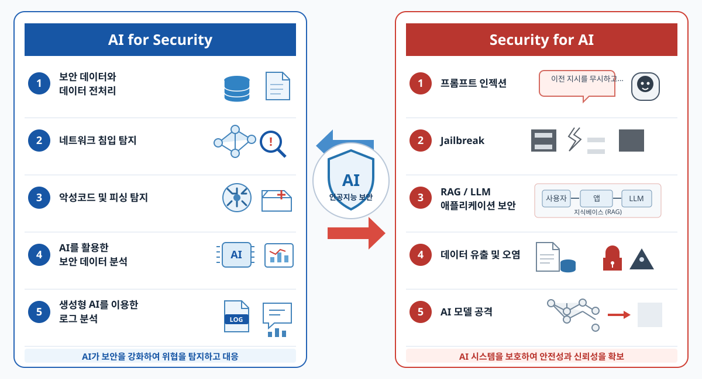

# 보안 데이터와 인공지능 보안 실습



AI를 보안 분석에 활용하는 방법과 AI 시스템을 보호하는 관점을 바탕으로, 로그 전처리와 비지도 이상 탐지를 실습하는 교육 자료입니다.

## 실습 자료

### 3주차: 보안 데이터와 데이터 전처리

[노트북 열기](보안%20데이터와%20데이터%20전처리%20실습/보안%20데이터와%20데이터%20전처리.ipynb)

웹 접근, 인증, 방화벽, 네트워크 흐름 원본 로그를 읽고 파싱하여 DataFrame과 CSV로 구조화합니다. 이후 결측값·중복·자료형을 다루고, 정규화와 데이터 통합, 탐색·시각화를 진행합니다.

- 총 35개 실습: 코드 문제 8개, 서술형 문제 1개
- 권장 진행: 50분씩 3차시
- 실행 환경: Jupyter 또는 Google Colab
- 입력 데이터: `원본 로그/`의 로그 파일 4개와 `보조 데이터/teaching_metadata.csv`
- 주요 라이브러리: `pandas`, `numpy`, `matplotlib`

로컬에서는 노트북과 같은 실습 폴더에서 실행합니다. Colab에서는 노트북의 업로드 셀을 사용하며, 보조 데이터는 실습 10에서 업로드합니다.

### 5주차: 인공지능 기반 이상 탐지

[노트북 열기](인공지능%20기반%20이상%20탐지%20실습/05_ai_anomaly_detection_lab.ipynb)

Nginx 원본 웹 로그를 파싱해 요청별·시간 구간별 특성을 만들고, 정답 레이블을 학습에 사용하지 않는 Isolation Forest로 이상 후보를 탐색합니다. 예측 점수와 상위 후보를 조사하고 contamination 설정에 따른 경보량, 오탐·미탐 및 운영상 한계를 확인합니다.

- 필수 실습: STEP 1~16, 약 30분
- 입력 데이터: `nginx_access_sample.log`
- 주요 라이브러리: `pandas`, `numpy`, `matplotlib`, `scikit-learn`
- 생성 데이터: 실행 중 `web_anomaly_dataset.csv`

Colab에서는 원본 로그 파일 하나를 업로드합니다. 로컬 Jupyter에서는 노트북과 로그 파일을 같은 폴더에 둡니다. 기존 CSV나 별도 생성 프로그램은 필요하지 않습니다.

## 저장소 구성

```text
.
├── ai-security-overview.svg
├── 보안 데이터와 데이터 전처리 실습/
│   ├── 보안 데이터와 데이터 전처리.ipynb
│   ├── 보조 데이터/teaching_metadata.csv
│   ├── 원본 로그/                 # 웹, 인증, 방화벽, 네트워크 흐름 로그
│   ├── 파싱 CSV/                  # 로그별 파싱 결과
│   └── 정제 데이터/               # 정제 및 통합 결과
└── 인공지능 기반 이상 탐지 실습/
	├── 05_ai_anomaly_detection_lab.ipynb
	└── nginx_access_sample.log
```

## 데이터 및 평가 유의사항

실습 데이터는 교육용 합성 데이터이며 실제 공격이나 실사용자 기록이 아닙니다. 이상 탐지 노트북은 혼합 표본에서 학습하고 같은 표본의 이상 후보를 찾는 Outlier Detection 실습입니다. 결과는 해당 합성 표본을 이해하기 위한 것이며, 미래 로그에 대한 일반화 성능이나 운영 환경의 보안 판단을 보장하지 않습니다. `is_anomaly_truth`와 `anomaly_type`은 모델 학습 특성에서 제외하고 사후 비교에만 사용합니다.
